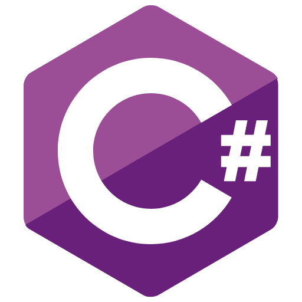
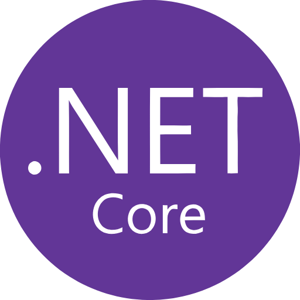

# 🌃 JavaPunk Coderunners 🌆

## Become the ultimate code runner!

JavaPunk Coderunners is a quiz-based learning platform where users can answer programming questions, complete modules, and earn points.

# Tech Stack:

☆ Backend: C# and ASP.NET Core (.NET 10)

☆ Frontend: React 19 with Vite 8 (JavaScript)

☆ Database: SQLite

☆ ORM: Entity Framework Core

☆ Authentication: JWT

# Prerequisites:

☆ Node.js

☆ .NET 10 SDK

         

